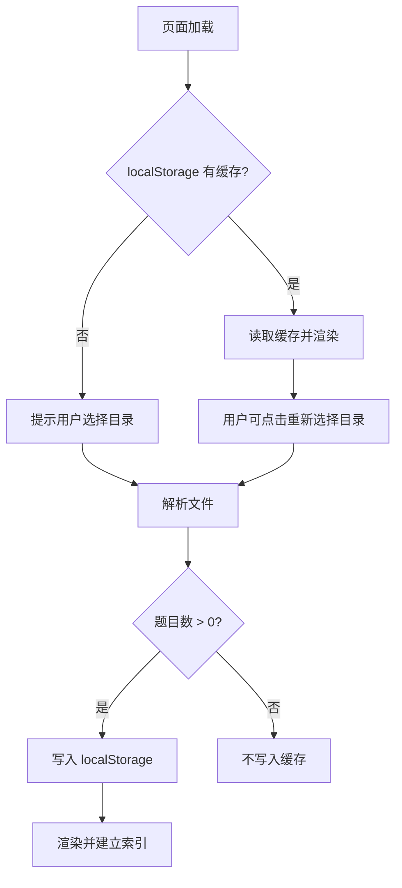
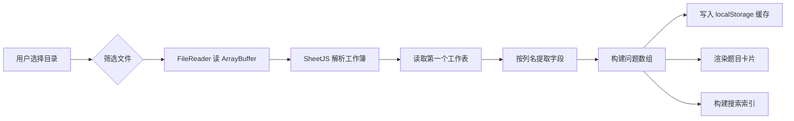
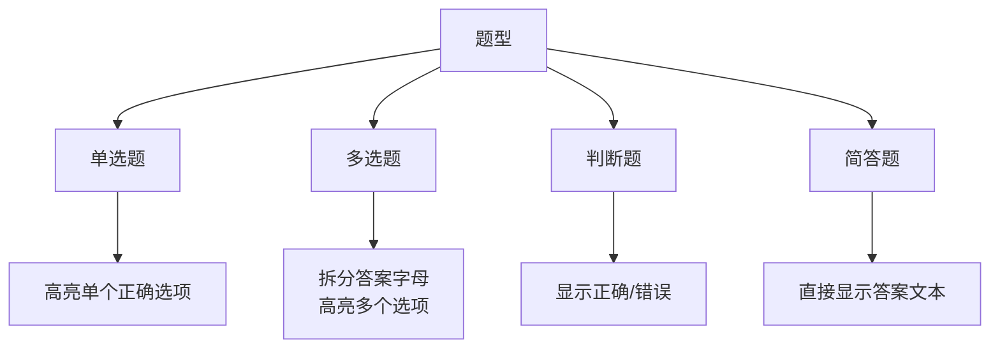

# 架构与设计决策

## 1. 单文件 HTML 架构

### 决策

最终交付物是单个 `exam-helper.html` 文件，所有依赖（解析库、拼音库、应用代码）全部内联。

### 理由

- **部署简单**：用户只需一个文件，双击即用。
- **离线可用**：不依赖 CDN，考场等无网环境也能用。
- **版本一致**：不会出现用户端依赖版本与应用不匹配的问题。

### 代价

- HTML 文件体积较大（约 1.3 MB），但在现代网络与本地文件场景下可接受。
- 构建步骤不可缺少，不能直接在源码 HTML 上交付。

## 2. 目录加载方案

### 浏览器限制

出于安全原因，浏览器无法静默读取本地文件系统。HTML 文件打开后不可能像桌面应用一样“自动扫描”某个固定路径。

### 选择：`<input type="file" webkitdirectory>`

- 用户手动选择一次目录后，浏览器返回该目录下（含子目录）的所有文件。
- 比 File System Access API 的 `showDirectoryPicker()` 兼容性更好，且在 `file://` 协议下更稳定。
- 解析结果缓存到 `localStorage`，下次打开先显示缓存，降低重复选择成本。

### 取舍

- 第一次必须用户交互，无法做到“完全自动”。
- 缓存容量受浏览器限制（通常 5–10 MB），对几千道题的场景足够，但不适合超大型题库。

### 缓存读写流程

## 3. 数据解析流程

### 为什么只读第一个工作表

现有题库文件都是“一个文件一个工作表”的约定。若未来需要多表，可在 `parseFile` 中改为遍历所有工作表并合并。

## 4. 搜索索引设计

为每道题预计算三个字段：

- `raw`：题干、选项、答案、依据、分类、文件名等原文的小写串。
- `full`：上述文本的完整拼音小写串。
- `initials`：上述文本的拼音首字母小写串。

检索时按空格分词，要求每个 token 至少命中上述三个字段之一（AND 关系）。

### 为什么预计算索引

- 题库数据量在加载后是静态的，预计算后搜索为 O(N×M) 字符串子串查找，对几千题而言实时性足够。
- 避免每次输入都重新调用拼音库，减少卡顿。

## 5. UI/UX 关键决策

### 卡片网格 + 按行分页

- 宽屏一行显示多个卡片，提高信息密度。
- 分页按“行数”而非“题数”计算，保证每一页底部不会留半行空白。
- 每页固定 10 行，列数由当前容器宽度动态计算。

### 答案高亮

- 单选题：匹配答案字母高亮对应选项。
- 多选题：答案如 `ABCD` 时，拆分为字母数组，高亮所有正确选项。
- 判断题/简答题：直接显示答案文本。

### 备注醒目

“备注”列在原始题库中常用于标记“保命题”等重点信息，因此用红色加粗单独展示，放在题干上方。

### UI 渲染流程

### 题型与展示方式映射

## 6. 依赖选型

| 依赖 | 用途 | 选型理由 |
|------|------|----------|
| SheetJS (`xlsx`) | 解析 `.xls/.xlsx/.csv` | 社区成熟，支持旧版 `.xls` 二进制格式，浏览器构建包可直接内联 |
| `js-pinyin` | 拼音与首字母生成 | 体积小（约 90 KB），API 简单，支持首字母提取 |

未使用框架（React/Vue 等），以保持单文件、零构建运行时、体积最小化。
