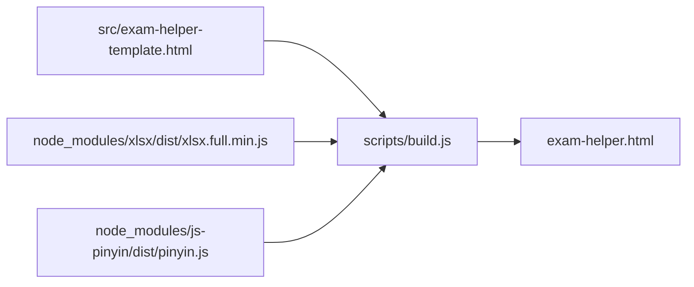
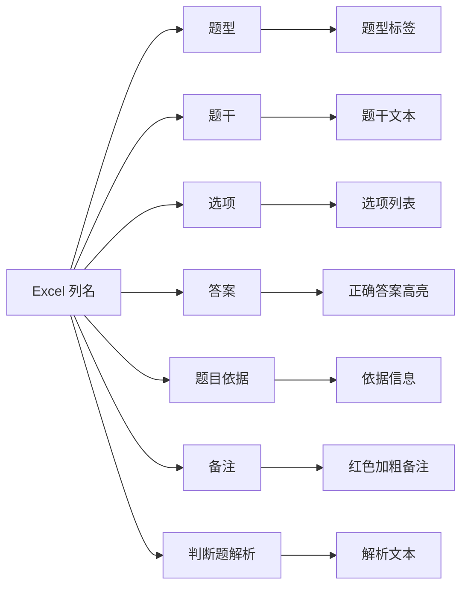

# 开发指南

## 环境要求

- Node.js 16+（用于构建与测试）
- 现代浏览器（Chromium / Edge / Chrome 推荐）

## 安装依赖

```bash
npm install
```

## 项目结构

```
.
├── docs/                          # 开发文档
├── node_modules/                  # 依赖
├── repository/                    # 私有题库（不进入版本控制）
├── scripts/
│   ├── build.js                   # 生成单文件 exam-helper.html
│   ├── generate-template.js       # 生成示例题库模板
│   ├── test-parse.js              # Node 端解析与检索验证
│   └── test-playwright.js         # 浏览器端端到端验证
├── src/
│   └── exam-helper-template.html  # 应用源码模板
├── templates/
│   └── question-bank-template.xlsx # 公开样例模板
├── exam-helper.html               # 最终产物（构建生成）
├── package.json
└── README.md
```

## 构建

```bash
npm run build
```

`scripts/build.js` 会：

1. 读取 `src/exam-helper-template.html`。
2. 将 `xlsx`（SheetJS）和 `js-pinyin` 的浏览器构建包以 base64 data URI 形式内联进 HTML。
3. 输出 `exam-helper.html`。

> 为什么用 base64 data URI？见 [lessons-learned.md](./lessons-learned.md)。



## 生成样例题库模板

```bash
node scripts/generate-template.js
```

输出 `templates/question-bank-template.xlsx`，可用于开源展示或作为用户制题参考。

## 测试

### 1. Node 端解析验证

```bash
node scripts/test-parse.js
```

验证：
- 现有题库目录下的文件能被 SheetJS 正确解析。
- 解析出的题目总数与文件一致。
- 中文、全拼、首字母搜索能命中预期结果。

### 2. 浏览器端端到端验证

```bash
node scripts/test-playwright.js
```

使用 Playwright + Chromium 真实浏览器：
- 打开 `exam-helper.html`。
- 模拟用户选择目录。
- 验证加载、搜索、分页、答案高亮等交互。

### 3. 手动验证

直接用浏览器打开 `exam-helper.html`，点击「选择题库目录」，选择 `templates/` 或私有题库目录，检查：
- 题目数量正确。
- 搜索、分页、高亮正常。
- 帮助窗口可打开/关闭。

## 发布流程

1. 修改 `src/exam-helper-template.html`。
2. 运行 `npm run build` 重新生成 `exam-helper.html`。
3. 运行测试脚本确认无回归。
4. 将 `exam-helper.html`、`templates/`、`README.md`、`docs/` 等公开内容发布。
5. **不要**将私有 `repository/` 目录一起发布。

## 题库列与展示字段映射



## 调试技巧

- 在浏览器中打开 `exam-helper.html`，按 `F12` 查看 Console。
- 若出现 `XLSX is not defined`，通常是内联库解析失败，检查构建产物是否有异常。
- 若缓存了错误数据，点击「清除缓存」后重新选择目录。
