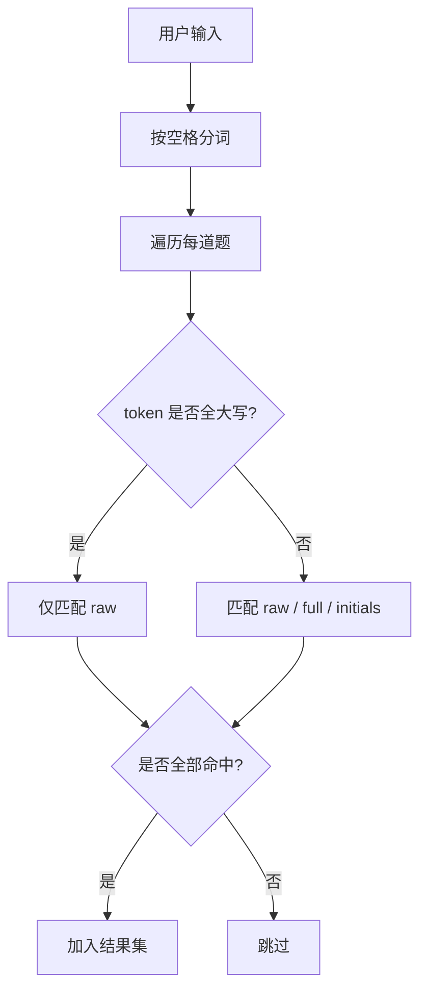

# 搜索设计

## 支持的查询形式

| 输入形式 | 示例 | 说明 |
|----------|------|------|
| 中文关键字 | `安全` | 匹配题干、选项、依据、分类、文件名等原文 |
| 全拼 | `anquan` | 匹配完整拼音 |
| 拼音首字母 | `aq` | 匹配各字段拼音首字母串 |
| 英文缩写 | `GDW` | 大写输入时仅按原文匹配，避免被拼音首字母干扰 |
| 多关键字且关系 | `工作负责人 工作票` | 空格分隔，多个条件必须同时满足 |

## 索引构建

加载题库后，对每道题调用 `js-pinyin` 生成：

```js
{
  raw:      "题干 选项 答案 依据 ...".toLowerCase(),
  full:     pinyin.getFullChars(...).toLowerCase(),
  initials: pinyin.getCamelChars(...).toLowerCase()
}
```

## 查询语义



1. 按空白字符分词。
2. 对每个 token：
   - 若 token 为全大写英文字母（如 `GDW`），视为英文缩写，**只匹配 `raw`**。
   - 其他情况，同时匹配 `raw`、`full`、`initials`。
3. 每道题必须满足所有 token（AND）。

### 为什么全大写英文只匹配 raw

实际题库中常见英文缩写（如 `Q/GDW`、`IEC`、`GB`）。如果也走拼音首字母索引，这些缩写会命中大量不相关的题目，导致结果集被“污染”。

用户若需要拼音首字母搜索，可输入小写形式（如 `aq`），此时会同时匹配首字母索引。

## 高亮

命中结果中，所有匹配的 token 会在题干和选项中以 `<mark>` 标黄，便于快速定位。

## 性能

- 索引在加载/搜索模式切换时只构建一次。
- 搜索过程是纯内存字符串 `indexOf`，无网络、无 DOM 重排。
- 对几千道题的场景，输入响应在毫秒级。

## 可扩展方向

- 支持 OR 语义：可用 `|` 或逗号分隔，实现“满足任一即可”。
- 支持字段限定：如 `type:单选题 关键字`。
- 支持模糊音、多音字：可替换为更大的拼音字典库，但会增加体积。
